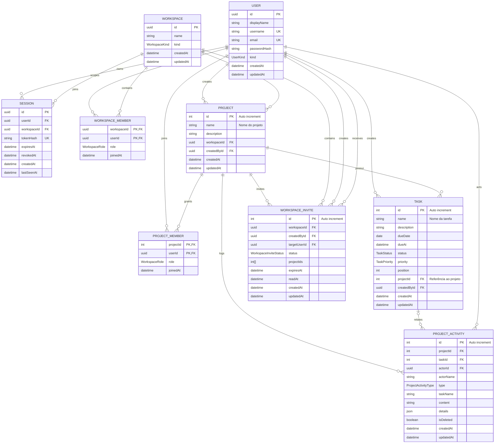

# Desafio Técnico One Investimentos - Formulário de Cadastro de Projetos e Tarefas

## Visão Geral

Este é um sistema full stack de gerenciamento de projetos e tarefas. É possível usar a aplicação como visitante ou criar uma conta com username e senha. Contas podem organizar dados em múltiplos workspaces e colaborar por meio de convites e permissões por projeto.

## Funcionalidades

- Projetos e tarefas com descrições opcionais, status, prioridade e prazo.
- Uso como visitante ou com conta, autenticação por username ou e-mail e workspaces pessoais ou compartilhados.
- Convites para workspaces por username; owners podem administrar membros e o acesso de cada pessoa aos projetos.
- Timeline de atividade do projeto e comentários no Chat.
- Interface responsiva com suporte a português e inglês e temas claro e escuro.

## Tecnologias Utilizadas

- **Frontend:** [Next.js](https://nextjs.org/docs)
- **Backend:** API Routes com [Hono](https://hono.dev/docs/)
- **Banco de Dados:** [PostgreSQL](https://www.postgresql.org/docs/) (via [Prisma ORM](https://www.prisma.io/docs))
- **Estilização:** [Tailwind CSS](https://tailwindcss.com/docs)
- **Containerização:** [Docker](https://docs.docker.com/) e [Docker Compose](https://docs.docker.com/compose/)

## Estrutura do Banco de Dados

O modelo inclui identidade e sessão (`User`, `Session`), workspace e memberships (`Workspace`, `WorkspaceMember`), além dos dados de produto (`Project`, `Task`).



## Desafio

### Especificação do Projeto

Desenvolver um sistema full stack de gerenciamento de projetos e tarefas utilizando Next.js, Hono e PostgreSQL. O sistema deve permitir operações CRUD completas em projetos e suas respectivas tarefas, com interface responsiva e arquitetura escalável. Os projetos possuem relacionamento one-to-many com tarefas, garantindo integridade referencial através de cascata na exclusão.

### Checklist de Entrega

**Backend**

- [x] API para criação de projetos
- [x] API para listagem de projetos
- [x] API para exclusão de projetos
- [x] API para criação de tarefas vinculadas a projetos
- [x] API para listagem de tarefas por projeto
- [x] API para exclusão de tarefas

**Frontend**

- [x] Interface para cadastro de projetos
- [x] Interface para visualização/listagem de projetos
- [x] Interface para cadastro de tarefas por projeto
- [x] Interface para visualização/listagem de tarefas associadas a projetos
- [x] Funcionalidade de exclusão de projetos e tarefas

### Requisitos Técnicos

- Utilizar Next.js para o frontend
- Implementar API Routes com Hono
- Utilizar Prisma ORM para manipulação do banco de dados PostgreSQL
- Criar uma interface intuitiva e responsiva
- Docker e Docker Compose são necessários para a execução do ambiente de desenvolvimento

## Instruções de Instalação

1. Clone este repositório.
2. Acesse o diretório do projeto:
   ```sh
   cd desafio-tecnico-one-fullstack
   ```
3. **Certifique-se de que o Docker e o Docker Compose estão instalados em seu sistema.**
4. Na primeira execução, crie o `.env` a partir do exemplo. Se já existir um
   `.env`, mantenha-o e confirme que `DATABASE_URL` aponta para o banco desejado.
   ```sh
   cp .env.example .env
   ```
   O exemplo usa o banco local `dev_db`. Não use uma URL de produção se não
   quiser que a aplicação local leia e altere dados de produção.
5. Construa e inicie a aplicação e o banco de dados:
   ```sh
   docker compose up --build -d
   ```
   Esse comando constrói a imagem e inicia os contêineres. O Compose passa
   `DATABASE_URL` do `.env` à aplicação. No contêiner, `localhost` é ajustado
   para o serviço PostgreSQL `db`; URLs de bancos externos permanecem inalteradas.
   O app aguarda o banco ficar saudável, aplica as migrations pendentes e então
   inicia. Acesse http://localhost:3000.
   Se precisar reiniciar a aplicação limpando o cache do Next.js, sem apagar os
   dados do banco, use:
   ```sh
   npm run dev:docker:clean
   ```
6. Para aplicar migrations explicitamente ao banco configurado em `DATABASE_URL`:
   ```sh
   npm run migrate:deploy
   ```
   Revise o destino antes de executar, especialmente quando `.env` aponta para
   produção. Na Vercel, configure `DATABASE_URL` nas Environment Variables do
   projeto; o build executa `prisma generate` antes de `next build`. Aplique as
   migrations de produção separadamente com `npm run migrate:deploy`.
7. (Opcional) Preencha o banco com algumas informações iniciais:
   ```sh
   docker compose exec app npm run db:seed
   ```
8. Para desenvolvimento diretamente no host ou para executar testes, instale as
   dependências com `npm ci` e crie cada arquivo a partir de seu próprio exemplo:
   ```sh
   cp .env.example .env
   cp .env.test.example .env.test
   ```
   `.env.example` aponta para `dev_db`; `.env.test.example` aponta para
   `test_db`. Depois, use `npm run dev` ou `npm run test`.
9. (Opcional) Execute os testes:
   ```sh
   npm run test
   ```

## Estrutura do Projeto

```
/desafio-tecnico-one-fullstack
├── prisma/                     # Esquema do banco de dados
├── src
    ├── server/                 # API Routes Hono
    ├── app/                    # Rotas do Next.js
    ├── components/             # Componentes reutilizáveis
    ├── constants/              # Constantes da aplicação
    ├── hooks/                  # React hooks customizados
    ├── lib/                    # Implementação de bibliotecas da aplicação
    ├── screens/                # Componentes de telas da aplicação
    ├── utils/                  # Funções de utilidades
├── tests/                      # Configuração de testes
├── .env                        # Variáveis de ambiente
├── .env.test                   # Variáveis de ambiente de teste
├── compose.yaml                # Compose do docker da base de dados
├── tailwind.config.ts          # Configuração tailwind
├── vitest.config.ts            # Configuração vitest
├── package.json                # Dependências do projeto
└── README.md                   # Documentação do projeto
```

## Endpoints da API

- `POST /api/session/guest`, `POST /api/session/account`, `POST /api/session/sign-in` e `POST /api/session/sign-out` - Inicia ou encerra sessões de visitante e de conta.
- `GET /api/session/workspace`, `PATCH /api/session/workspace`, `POST /api/session/workspace`, `PATCH /api/session/workspace/:workspaceId` e `DELETE /api/session/workspace/:workspaceId` - Lista, troca, cria, renomeia ou exclui workspaces.
- `GET /api/session/workspace/:workspaceId/members`, `PUT /api/session/workspace/:workspaceId/members/:userId/projects` e `DELETE /api/session/workspace/:workspaceId/members/:userId` - Lista membros, atualiza o acesso a projetos ou remove uma pessoa do workspace.
- `GET /api/session/workspace/:workspaceId/invites` e `POST /api/session/workspace/:workspaceId/invite` - Lista e cria convites do workspace.
- `GET /api/session/workspace/invites`, `PATCH /api/session/workspace/invites/:inviteId/read`, `POST /api/session/workspace/invites/:inviteId/accept`, `POST /api/session/workspace/invites/:inviteId/decline` e `DELETE /api/session/workspace/invites/:inviteId` - Lista e atualiza convites recebidos.
- `GET /api/project`, `POST /api/project`, `PATCH /api/project/:id` e `DELETE /api/project/:id` - Lista, cria, atualiza ou exclui projetos autorizados.
- `GET /api/project/:projectId/activity`, `POST /api/project/:projectId/comments`, `PATCH /api/project/:projectId/activity/:activityId` e `DELETE /api/project/:projectId/activity/:activityId` - Consulta atividade e cria, edita ou exclui comentários.
- `GET /api/task?projectId=:id`, `POST /api/task`, `PATCH /api/task/:id`, `DELETE /api/task/:id` e `PATCH /api/task/reorder` - Lista, cria, atualiza, exclui ou reordena tarefas autorizadas.

## Considerações

- Utilize boas práticas de desenvolvimento e organização de código.
- Documente claramente qualquer decisão arquitetural relevante.
- O reset/migração do banco de dados de testes foi centralizado no script de teste (`npm run test`) para evitar conflitos e duplicidade de comandos, garantindo que o ambiente de testes seja sempre inicializado de forma consistente.
- Documentação com hono-openapi (Swagger) disponível em: http://localhost:3000/swagger.html

## Adicionais

**Backend**

- [x] API para edição de projetos
- [x] API para edição de tarefas
- [x] Testes para edição de projetos
- [x] Testes para edição de tarefas
- [x] Documentação com hono-openapi (Swagger)

**FrontEnd**

- [x] Interface para edição de projetos
- [x] Interface para edição de tarefas
- [x] Internacionalização de interfaces
- [x] Sistema de design com modos claro e escuro

---

Boa sorte no desafio! 🚀

## Minha checklist

- [x] <a id="autoavaliacao"></a>[1º Autoavaliação](docs/01-autoavaliacao.md)

- [x] <a id="improvements"></a>[2º Improvements](docs/02-improvements.md)
  - [x] API: validar tipos e limites dos dados, IDs positivos e padronizar erros
  - [x] API: compartilhar schemas entre validação e documentação OpenAPI
  - [x] Testes: exigir resultados específicos, isolar dados e cobrir a rota Next.js
  - [x] Interface: melhorar hierarquia visual, estados de tela, acessibilidade e responsividade
  - [x] Operação: adicionar CI, e health checks
  - [x] Operação: validar build e lint em produção e corrigir warnings/erros que bloqueiem a compilação
  - [x] Arquitetura: avaliar provedores de cliente e manter no servidor o que não exige interação

- [ ] <a id="news"></a>[3º News](docs/03-news.md)
  - [x] [Validar o CI no GitHub Actions](docs/03-news.md#validar-o-ci-no-github-actions)
  - [x] [Adicionar descrição opcional às tarefas e projetos](docs/03-news.md#descricao-opcional)
  - [x] [Adicionar status às tarefas (`todo`, `in_progress`, `done`)](docs/03-news.md#task-status)
  - [x] [Adicionar prioridade às tarefas (`low`, `normal`, `high`)](docs/03-news.md#task-priority)
  - [x] [Adicionar horário opcional ao prazo da tarefa](docs/03-news.md#task-due-time)
  - [x] [Adicionar identidade guest e isolamento por workspace](docs/03-news.md#guest-workspace)
  - [x] [Adicionar contas e múltiplos workspaces](docs/03-news.md#account-workspaces)
  - [x] [Convidar membros e controlar acesso a projetos](docs/03-news.md#workspace-members-and-invites)
  - [x] [Consultar atividade e comentários no Chat do projeto](docs/03-news.md#project-chat)
  - [x] [Identificar o username usado em convites](docs/03-news.md#username-invites)
