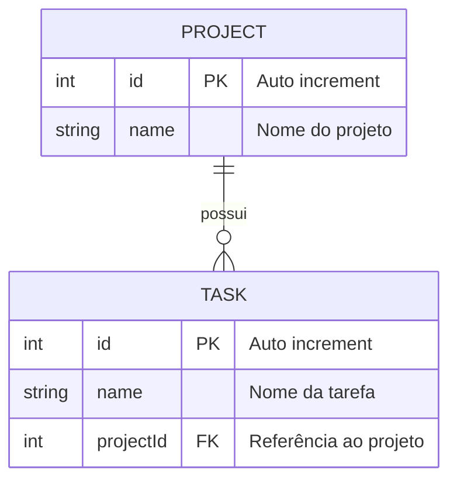

# Desafio Técnico One Investimentos - Formulário de Cadastro de Projetos e Tarefas

## Visão Geral

Este é um desafio técnico full stack que consiste no desenvolvimento de um sistema de cadastro de projetos e tarefas. A aplicação deve permitir que os usuários criem projetos e adicionem tarefas relacionadas a cada projeto.

## Tecnologias Utilizadas

- **Frontend:** [Next.js](https://nextjs.org/docs)
- **Backend:** API Routes com [Hono](https://hono.dev/docs/)
- **Banco de Dados:** [PostgreSQL](https://www.postgresql.org/docs/) (via [Prisma ORM](https://www.prisma.io/docs))
- **Estilização:** [Tailwind CSS](https://tailwindcss.com/docs)
- **Containerização:** [Docker](https://docs.docker.com/) e [Docker Compose](https://docs.docker.com/compose/)

## Estrutura do Banco de Dados

A estrutura do banco de dados é baseada em duas entidades: **Project** e **Task**.



```prisma
model Project {
  id   Int    @id @default(autoincrement())
  name String

  tasks Task[]

  @@map("projects")
}

model Task {
  id   Int    @id @default(autoincrement())
  name String

  projectId Int
  project   Project @relation(fields: [projectId], references: [id], onDelete: Cascade)

  @@map("tasks")
}
```

## Desafio

### Especificação do Projeto

Desenvolver um sistema full stack de gerenciamento de projetos e tarefas utilizando Next.js, Hono e PostgreSQL. O sistema deve permitir operações CRUD completas em projetos e suas respectivas tarefas, com interface responsiva e arquitetura escalável. Os projetos possuem relacionamento one-to-many com tarefas, garantindo integridade referencial através de cascata na exclusão.

### Checklist de Entrega

**Backend**

- [x] API para criação de projetos
- [x] API para listagem de projetos
- [x] API para exclusão de projetos
- [x] API para criação de tarefas vinculadas a projetos
- [x] API para listagem de tarefas por projeto
- [x] API para exclusão de tarefas

**Frontend**

- [x] Interface para cadastro de projetos
- [x] Interface para visualização/listagem de projetos
- [x] Interface para cadastro de tarefas por projeto
- [x] Interface para visualização/listagem de tarefas associadas a projetos
- [x] Funcionalidade de exclusão de projetos e tarefas

### Requisitos Técnicos

- Utilizar Next.js para o frontend
- Implementar API Routes com Hono
- Utilizar Prisma ORM para manipulação do banco de dados PostgreSQL
- Criar uma interface intuitiva e responsiva
- Docker e Docker Compose são necessários para a execução do ambiente de desenvolvimento

## Instruções de Instalação

1. Clone este repositório.
2. Acesse o diretório do projeto:
   ```sh
   cd desafio-tecnico-one-fullstack
   ```
3. **Certifique-se de que o Docker e o Docker Compose estão instalados em seu sistema.**
4. Inicie a aplicação e o banco de dados:
   ```sh
   docker compose up --build -d
   ```
   O Compose aguarda o PostgreSQL ficar pronto, aplica as migrations e inicia a
   aplicação. Acesse http://localhost:3000.
5. (Opcional) Preencha o banco com algumas informações iniciais:
   ```sh
   docker compose exec app npm run db:seed
   ```
6. Para desenvolvimento diretamente no host ou para executar testes, instale as
   dependências com `npm ci` e crie cada arquivo a partir de seu próprio exemplo:
   ```sh
   cp .env.example .env
   cp .env.test.example .env.test
   ```
   `.env.example` aponta para `dev_db`; `.env.test.example` aponta para
   `test_db`. Depois, use `npm run dev` ou `npm run test`.
7. (Opcional) Execute os testes:
   ```sh
   npm run test
   ```

## Estrutura do Projeto

```
/desafio-tecnico-one-fullstack
├── prisma/                     # Esquema do banco de dados
├── src
    ├── server/                 # API Routes Hono
    ├── app/                    # Rotas do Next.js
    ├── components/             # Componentes reutilizáveis
    ├── constants/              # Constantes da aplicação
    ├── hooks/                  # React hooks customizados
    ├── lib/                    # Implementação de bibliotecas da aplicação
    ├── screens/                # Componentes de telas da aplicação
    ├── utils/                  # Funções de utilidades
├── tests/                      # Configuração de testes
├── .env                        # Variáveis de ambiente
├── .env.test                   # Variáveis de ambiente de teste
├── compose.yaml                # Compose do docker da base de dados
├── tailwind.config.ts          # Configuração tailwind
├── vitest.config.ts            # Configuração vitest
├── package.json                # Dependências do projeto
└── README.md                   # Documentação do projeto

```

## Endpoints da API

- `GET /api/project` - Lista todos os projetos
- `POST /api/project` - Cria um novo projeto

## Considerações

- Utilize boas práticas de desenvolvimento e organização de código.
- Documente claramente qualquer decisão arquitetural relevante.
- O reset/migração do banco de dados de testes foi centralizado no script de teste (`npm run test`) para evitar conflitos e duplicidade de comandos, garantindo que o ambiente de testes seja sempre inicializado de forma consistente.
- Documentação com hono-openapi (Swagger) disponível em: http://localhost:3000/swagger.html

## Adicionais

**Backend**

- [x] API para edição de projetos
- [x] API para edição de tarefas
- [x] Testes para edição de projetos
- [x] Testes para edição de tarefas
- [x] Documentação com hono-openapi (Swagger)

**FrontEnd**

- [x] Interface para edição de projetos
- [x] Interface para edição de tarefas
- [x] Internacionalização de interfaces
- [x] Sistema de design com modos claro e escuro

---

Boa sorte no desafio! 🚀

## Minha checklist

- [x] <a id="autoavaliacao"></a>[1º Autoavaliação](docs/01-autoavaliacao.md)

- [x] <a id="improvements"></a>[2º Improvements](docs/02-improvements.md)
  - [x] API: validar tipos e limites dos dados, IDs positivos e padronizar erros
  - [x] API: compartilhar schemas entre validação e documentação OpenAPI
  - [x] Testes: exigir resultados específicos, isolar dados e cobrir a rota Next.js
  - [x] Interface: melhorar hierarquia visual, estados de tela, acessibilidade e responsividade
  - [x] Operação: adicionar CI, e health checks
  - [x] Operação: validar build e lint em produção e corrigir warnings/erros que bloqueiem a compilação
  - [x] Arquitetura: avaliar provedores de cliente e manter no servidor o que não exige interação

- [ ] <a id="news"></a>[3º News](docs/03-news.md)
  - [x] [Validar o CI no GitHub Actions](docs/03-news.md#validar-o-ci-no-github-actions)
  - [x] [Adicionar descrição opcional às tarefas e projetos](docs/03-news.md#descricao-opcional)
  - [x] [Adicionar status às tarefas (`todo`, `in_progress`, `done`)](docs/03-news.md#task-status)
  - [ ] [Adicionar prioridade às tarefas (`low`, `normal`, `high`)](docs/03-news.md#task-priority)
