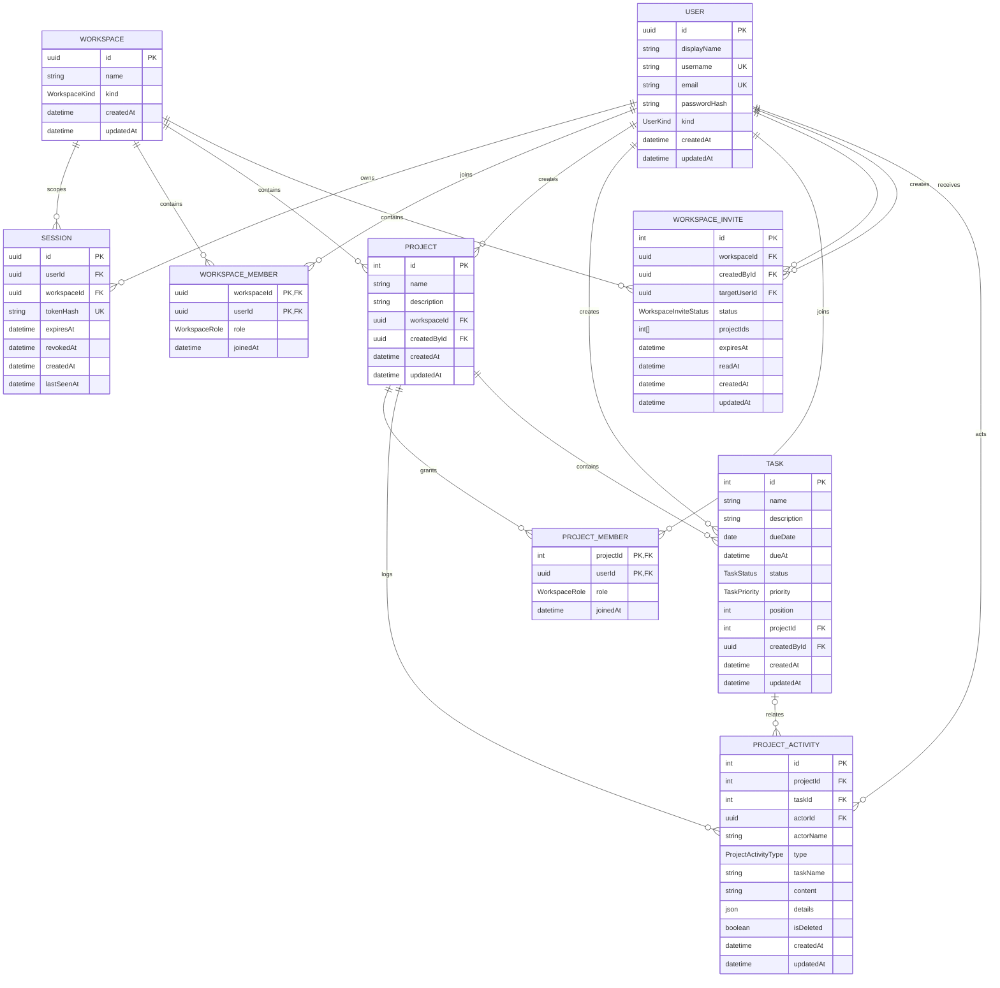

# Modelo de dados

O banco PostgreSQL é gerenciado pelo Prisma. Migrations versionadas estão em `prisma/migrations` e são aplicadas automaticamente no startup do app Docker.

## Isolamento e acesso

- Cada workspace contém seus projetos e memberships.
- Sessões identificam a pessoa e o workspace ativo.
- Owners administram o workspace e os convites.
- Membros recebem acesso explícito aos projetos compartilhados.
- A API verifica essas relações no servidor antes de retornar ou alterar dados.
